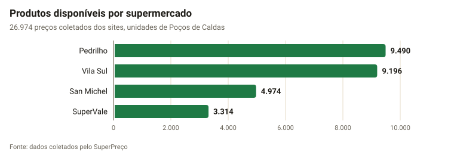
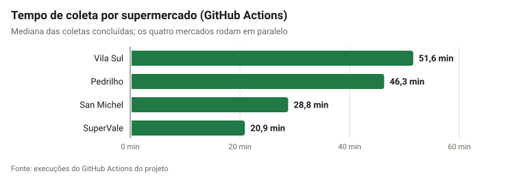
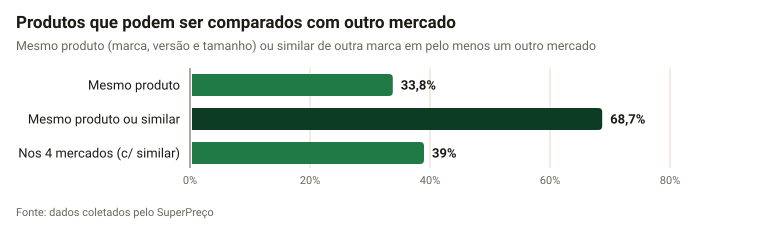
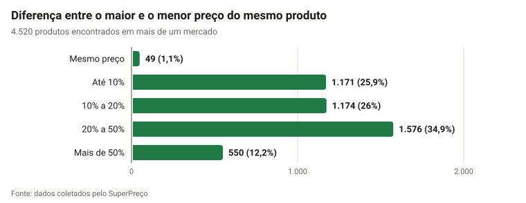
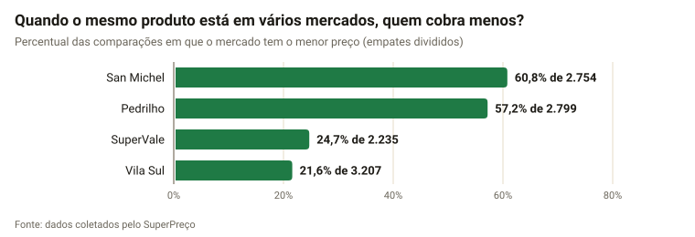
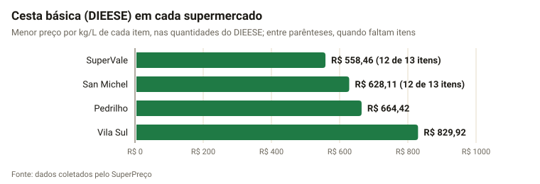
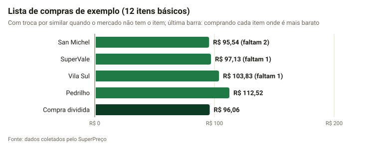
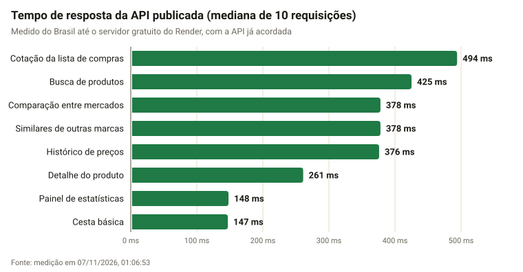

# Resultados: análise dos dados coletados

Relatório gerado por `npm --prefix backend run analise` em **07/11/2026, 01:06:53**, a partir do banco `Mercados`.
Figuras em `graficos/` (SVG), tabelas em `dados/` (CSV, separador `;`) e todos os números em `dados.json`.

> Os números mudam a cada coleta. Rode o script de novo perto da entrega para atualizar o capítulo.

## 1. Dados coletados

| Supermercado | Produtos | Alimentos | Em oferta | Com preço por kg/L/un | Última coleta |
| --- | ---: | ---: | ---: | ---: | --- |
| SuperVale | 3.314 | 2.122 | 196 | 3.092 | 06/11/2026, 21:53:57 |
| Vila Sul | 9.196 | 5.897 | 401 | 8.330 | 06/11/2026, 22:20:56 |
| San Michel | 4.974 | 3.098 | 166 | 4.335 | 06/11/2026, 22:00:38 |
| Pedrilho | 9.490 | 5.468 | 0 | 8.603 | 06/11/2026, 22:20:37 |

- **Total:** 26.974 produtos disponíveis e 1.464 indisponíveis (saíram do site).
- **Departamentos:** 13 categorias padronizadas. As maiores são Higiene e Saúde (4.910), Mercearia (3.442), Bebidas (3.093).

**Atualização periódica (GitHub Actions).**
- **Execuções:** 30 coletas concluídas, 30 delas agendadas (6h e 18h).
- **Mercados coletados:** 120 de 120 terminaram com sucesso (100%).
- **Tempo:** cada mercado roda em paralelo, então a coleta completa leva o tempo do mais lento, cerca de 51,6 min.

## 2. Comparação entre mercados

| Supermercado | Produtos | Mesmo produto em outro mercado | Mesmo ou similar | Comparável nos 4 mercados |
| --- | ---: | ---: | ---: | ---: |
| SuperVale | 3.314 | 52,1% | 84,1% | 53,5% |
| Vila Sul | 9.196 | 29,5% | 63,1% | 34,6% |
| San Michel | 4.974 | 45,9% | 75,5% | 41,3% |
| Pedrilho | 9.490 | 25,1% | 65% | 37,1% |
| **Geral** | **26.974** | **33,8%** | **68,7%** | **39%** |

- **Mesmo produto:** só 33,8% dos produtos aparecem em pelo menos um outro mercado com a mesma marca, versão e tamanho.
- **Com similares:** contando produtos parecidos de outra marca, 68,7% passam a ter com o que comparar. Os similares têm o mesmo tipo e departamento e tamanho até 25% diferente, comparados por kg/L/un.
- **Por que isso importa:** a diferença justifica a funcionalidade de similares, que na lista de compras aparecem separados dos totais.

### Diferença de preço do mesmo produto

- **Produtos comparados:** 4.520 produtos estão em mais de um mercado.
- **Diferença entre o maior e o menor preço:** em média 26,1% (mediana 18,5%), ou R$ 2,54 por produto.
- **Acima de 20%:** em 2.126 produtos (47%).
- **Mesmo preço em todos:** só 49 produtos.
- **Metade dos produtos:** diferença de até 18,5%; três quartos, até 32,7%.
- **Casos anormais:** 78 produtos com o maior preço acima do triplo do menor ficaram fora das contas. Quase sempre são erro de identificação ou de cadastro no site (ex.: Abacate 1kg (qtd.aprox.1un ) (supervale, R$ 5.99) × Abacate (pedrilho, R$ 2.99) × Abacate 1kg (vilasul, R$ 37.79)).
- **Precisão da comparação:** na conferência manual de 50 pares sorteados, 44 eram de fato o mesmo produto (88%).

**Comparação de dois em dois mercados** (produtos vendidos nos dois):

| Mercados (A × B) | Produtos em comum | A mais barato | B mais barato | Mesmo preço |
| --- | ---: | ---: | ---: | ---: |
| San Michel × Vila Sul | 1.900 | 80,6% | 18,5% | 0,9% |
| Pedrilho × Vila Sul | 1.730 | 69,7% | 28,8% | 1,4% |
| Pedrilho × San Michel | 1.390 | 45,4% | 51,6% | 3% |
| Pedrilho × SuperVale | 1.353 | 69,9% | 26,6% | 3,5% |
| SuperVale × Vila Sul | 1.328 | 50,5% | 48,2% | 1,4% |
| San Michel × SuperVale | 1.112 | 68,3% | 24,6% | 7% |

**Mercado com o menor preço mais vezes, por categoria:**

| Categoria | Produtos comparados | Mais barato mais vezes | % das vezes |
| --- | ---: | --- | ---: |
| Higiene e Saúde | 824 | San Michel | 38,8% |
| Mercearia | 722 | San Michel | 34,4% |
| Bebidas | 580 | Pedrilho | 36,1% |
| Biscoitos e Chocolates | 514 | San Michel | 47,6% |
| Matinais e Sobremesas | 490 | Pedrilho | 43,7% |
| Limpeza | 458 | Pedrilho | 44,7% |
| Frios e Laticínios | 331 | San Michel | 46,7% |
| Bazar e Utilidades | 210 | Pedrilho | 40,2% |
| Congelados | 131 | Pedrilho | 45,8% |
| Padaria | 97 | Pedrilho | 42,3% |
| Hortifruti | 70 | Pedrilho | 50,7% |
| Carnes e Peixes | 54 | Pedrilho | 40,7% |
| Pet | 39 | San Michel | 41% |

## 3. Cesta básica e lista de compras

| Supermercado | Cesta básica | Itens encontrados |
| --- | ---: | ---: |
| SuperVale | R$ 558,46 | 12 de 13 |
| San Michel | R$ 628,11 | 12 de 13 |
| Pedrilho | R$ 664,42 | 13 de 13 |
| Vila Sul | R$ 829,92 | 13 de 13 |

- **Mais barato com a cesta completa:** Pedrilho, com R$ 664,42.
- **Mais caro:** Vila Sul, com R$ 829,92. A diferença é de R$ 165,50 por mês (24,9%).
- **SuperVale** não entra na comparação do total: falta Tomate no site.
- **San Michel** não entra na comparação do total: falta Pão francês no site.

**Lista de exemplo** com 12 itens básicos, um de cada. Para cada item foi escolhido o produto vendido no maior número de mercados:

| Item procurado | Produto | Mercado |
| --- | --- | --- |
| arroz tipo 1 5kg | Arroz Polido Tipo 1 Super Ecco Pacote 5kg | Pedrilho |
| feijao carioca 1kg | Feijão Carioca Du Irineu 1kg | San Michel |
| acucar refinado 1kg | Açúcar Refinado União 1kg | San Michel |
| cafe 500g | Café 3 Corações Extra Forte 500g | Vila Sul |
| oleo soja 900ml | Óleo Soja Liza Pet 900ml | San Michel |
| leite integral 1l | Leite Quata 1l Integral | San Michel |
| macarrao espaguete 500g | Macarrao Galo Semola Espaguete Furadinho Pa 500g | SuperVale |
| farinha trigo 1kg | Farinha De Trigo Renata Dia A Dia 1kg | San Michel |
| sal refinado 1kg | Sal Refinado Cisne Pacote 1kg | Pedrilho |
| margarina 500g | Margarina Doriana Sem Sal 500gr | SuperVale |
| molho tomate | Molho De Tomate Fugini Tradicional 300g | Vila Sul |
| achocolatado 400g | Achocolatado em Pó Muky Chocolate Pacote 400g | Pedrilho |

| Supermercado | Total (só produtos iguais) | Itens encontrados | Itens faltando |
| --- | ---: | ---: | ---: |
| San Michel | R$ 95,54 | 10 | 2 |
| SuperVale | R$ 97,13 | 11 | 1 |
| Vila Sul | R$ 103,83 | 11 | 1 |
| Pedrilho | R$ 112,52 | 12 | 0 |

- **Melhor mercado:** Pedrilho, com R$ 112,52.
- **Mais caro com a lista completa:** Pedrilho, com R$ 112,52. A diferença é de R$ 0,00 (0%).
- **Compra dividida** (cada item no mercado onde é mais barato): R$ 96,06, R$ 16,46 a menos que o melhor mercado.

## 4. Variação de preços no período

A variação é medida só a partir de 15/10/2026. Antes disso, o histórico mistura mudanças reais com efeitos das correções feitas na coleta, como a troca do preço por kg pelo preço da embalagem, que apareceriam como altas e quedas que não aconteceram.

- **Período:** 2026-10-15 a 2026-11-07.
- **Registros:** 11.605 registros de preço de 6.842 produtos.
- **Mudanças de preço:** 4.206 (2.749 altas e 1.457 quedas), em 2.406 produtos.
- **Tamanho típico da mudança:** alta mediana de 22,2% e queda mediana de -19,2%.

**Maiores altas:**

| Produto | Mercado | Data | De | Para | Variação |
| --- | --- | --- | ---: | ---: | ---: |
| Chocolate Moranguete Bel 13gr | SuperVale | 2026-10-31 | R$ 0,80 | R$ 10,00 | 1150% |
| Cerveja Lager Puro Malte Amstel Lata 350ml | Pedrilho | 2026-10-19 | R$ 3,90 | R$ 46,80 | 1100% |
| Cerveja Lager Puro Malte Amstel Lata 350ml | Pedrilho | 2026-10-21 | R$ 3,90 | R$ 46,80 | 1100% |
| Cerveja Lager Puro Malte Amstel Lata 350ml | Pedrilho | 2026-10-22 | R$ 3,90 | R$ 46,80 | 1100% |
| Cerveja Lager Puro Malte Amstel Lata 350ml | Pedrilho | 2026-10-23 | R$ 3,90 | R$ 46,80 | 1100% |

**Maiores quedas:**

| Produto | Mercado | Data | De | Para | Variação |
| --- | --- | --- | ---: | ---: | ---: |
| Cerveja Lager Puro Malte Amstel Lata 350ml | Pedrilho | 2026-10-17 | R$ 46,80 | R$ 3,90 | -91,7% |
| Cerveja Lager Puro Malte Amstel Lata 350ml | Pedrilho | 2026-10-20 | R$ 46,80 | R$ 3,90 | -91,7% |
| Cerveja Lager Puro Malte Amstel Lata 350ml | Pedrilho | 2026-10-22 | R$ 46,80 | R$ 3,90 | -91,7% |
| Cerveja Lager Puro Malte Amstel Lata 350ml | Pedrilho | 2026-10-23 | R$ 46,80 | R$ 3,90 | -91,7% |
| Cerveja Lager Puro Malte Amstel Lata 350ml | Pedrilho | 2026-10-24 | R$ 46,80 | R$ 3,90 | -91,7% |

## 5. Tempo de resposta da API

Medido em 07/11/2026, 01:06:53, contra `https://superpreco-api.onrender.com/api`.
- **Primeira resposta:** 21.845 ms. Inclui acordar o servidor gratuito se ele estava parado.
- **Demais respostas:** mediana e percentil 90 de 10 requisições por rota.

| Rota | Caminho | Mediana | Percentil 90 |
| --- | --- | ---: | ---: |
| Busca de produtos | `/produtos` | 425 ms | 431 ms |
| Detalhe do produto | `/produtos/:id` | 261 ms | 271 ms |
| Comparação entre mercados | `/produtos/:id/comparacao` | 378 ms | 388 ms |
| Similares de outras marcas | `/produtos/:id/similares` | 378 ms | 382 ms |
| Histórico de preços | `/produtos/:id/historico` | 376 ms | 378 ms |
| Cotação da lista de compras | `/lista/cotacao` | 494 ms | 499 ms |
| Cesta básica | `/cesta-basica` | 147 ms | 150 ms |
| Painel de estatísticas | `/estatisticas` | 148 ms | 162 ms |

## 6. Avaliação com usuários

Roteiro e planilhas em `docs/avaliacao/`. A conferência dos requisitos do TCC também está lá.

**Tempo da pesquisa de preços:** ainda não aplicado. Preencha `docs/avaliacao/tempo.csv`.

**Usabilidade (SUS).**
- **Pontuação média:** 87,2 (desvio padrão 14,9), de 0 a 100, com 38 participantes.
- **Faixa:** de 45 a 100.
- **Acima da média de referência (68):** 32 de 38 participantes.

## Figuras

1. `graficos/produtos-por-mercado.svg`: Produtos disponíveis por supermercado
2. `graficos/cobertura-da-comparacao.svg`: Produtos que podem ser comparados com outro mercado
3. `graficos/mais-barato-por-mercado.svg`: Quantas vezes cada mercado tem o menor preço do mesmo produto
4. `graficos/diferenca-de-preco.svg`: Diferença de preço do mesmo produto entre os mercados
5. `graficos/cesta-basica.svg`: Custo da cesta básica (DIEESE) em cada mercado
6. `graficos/lista-de-compras.svg`: Total de uma lista de compras de exemplo em cada mercado
7. `graficos/tempo-de-coleta.svg`: Tempo da coleta de cada mercado no GitHub Actions
8. `graficos/tempo-de-resposta-da-api.svg`: Tempo de resposta da API publicada
