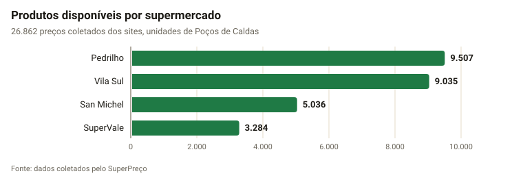
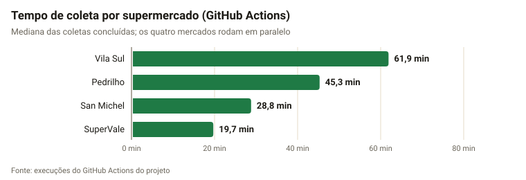
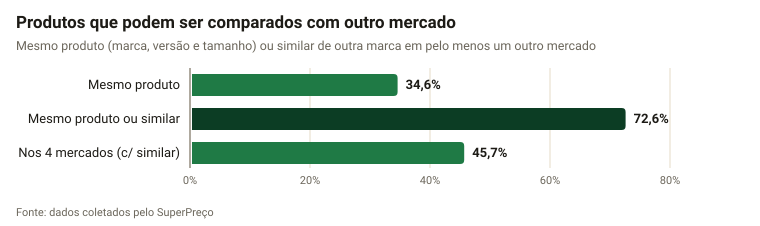
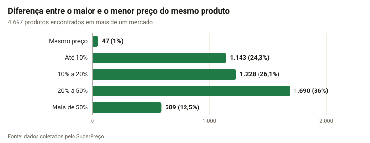
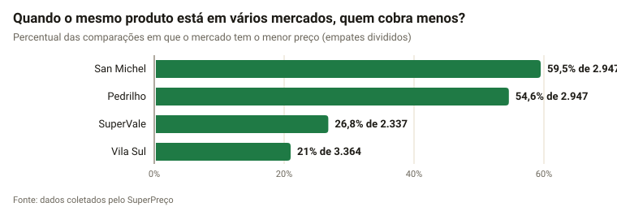
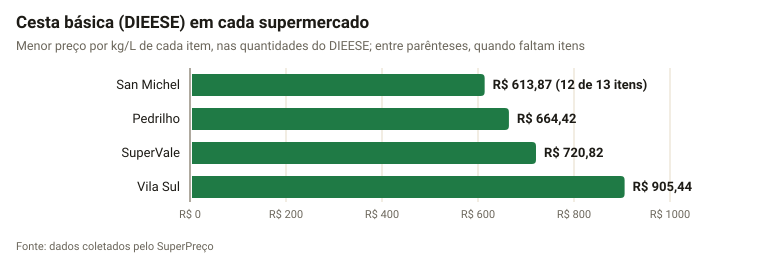
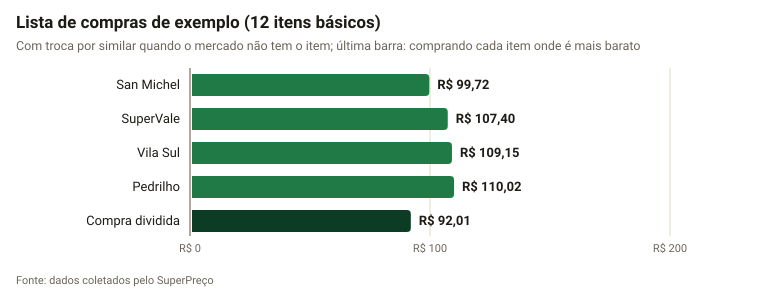
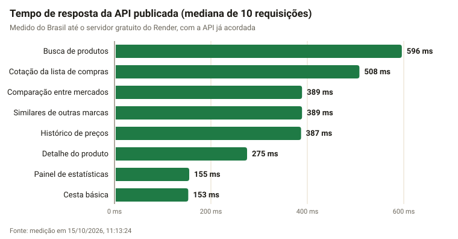

# Resultados: análise dos dados coletados

Relatório gerado por `npm --prefix backend run analise` em **15/10/2026, 19:47:41**, a partir do banco `Mercados`.
Figuras em `graficos/` (SVG), tabelas em `dados/` (CSV, separador `;`) e todos os números em `dados.json`.

> Os números mudam a cada coleta. Rode o script de novo perto da entrega para atualizar o capítulo.

## 1. Dados coletados

| Supermercado | Produtos | Alimentos | Em oferta | Com preço por kg/L/un | Última coleta |
| --- | ---: | ---: | ---: | ---: | --- |
| SuperVale | 3.284 | 2.114 | 130 | 3.075 | 15/10/2026, 11:19:19 |
| Vila Sul | 9.035 | 5.827 | 460 | 8.204 | 15/10/2026, 11:51:30 |
| San Michel | 5.036 | 3.160 | 125 | 4.396 | 15/10/2026, 11:33:01 |
| Pedrilho | 9.507 | 5.500 | 0 | 8.620 | 15/10/2026, 11:39:25 |

- **Total:** 26.862 produtos disponíveis e 171 indisponíveis (saíram do site).
- **Departamentos:** 13 categorias padronizadas. As maiores são Higiene e Saúde (4.851), Mercearia (3.453), Bebidas (3.011).

**Atualização periódica (GitHub Actions).**
- **Execuções:** 2 coletas concluídas, 1 delas agendadas (6h e 18h).
- **Mercados coletados:** 8 de 8 terminaram com sucesso (100%).
- **Tempo:** cada mercado roda em paralelo, então a coleta completa leva o tempo do mais lento, cerca de 60,1 min.

## 2. Comparação entre mercados

| Supermercado | Produtos | Mesmo produto em outro mercado | Mesmo ou similar | Comparável nos 4 mercados |
| --- | ---: | ---: | ---: | ---: |
| SuperVale | 3.284 | 52,6% | 86,3% | 59,3% |
| Vila Sul | 9.035 | 30,7% | 68,5% | 41,9% |
| San Michel | 5.036 | 46,7% | 78,3% | 49% |
| Pedrilho | 9.507 | 25,9% | 69% | 43,6% |
| **Geral** | **26.862** | **34,7%** | **72,7%** | **45,9%** |

- **Mesmo produto:** só 34,7% dos produtos aparecem em pelo menos um outro mercado com a mesma marca, versão e tamanho.
- **Com similares:** contando produtos parecidos de outra marca, 72,7% passam a ter com o que comparar. Os similares têm o mesmo tipo e departamento e tamanho até 25% diferente, comparados por kg/L/un.
- **Por que isso importa:** a diferença justifica a funcionalidade de similares e de substitutos na lista de compras.

### Diferença de preço do mesmo produto

- **Produtos comparados:** 4.697 produtos estão em mais de um mercado.
- **Diferença entre o maior e o menor preço:** em média 26,7% (mediana 19,3%), ou R$ 2,61 por produto.
- **Acima de 20%:** em 2.279 produtos (48,5%).
- **Mesmo preço em todos:** só 47 produtos.
- **Metade dos produtos:** diferença de até 19,3%; três quartos, até 33,4%.
- **Casos anormais:** 81 produtos com o maior preço acima do triplo do menor ficaram fora das contas. Quase sempre são erro de identificação ou de cadastro no site (ex.: Lasanha Seara 4 Queijos 600gr (supervale, R$ 16.99) × Lasanha 4 Queijos Seara Caixa 600g (pedrilho, R$ 6.6) × Lasanha Seara 4 Queijos 600gr (sanmichel, R$ 15.99) × Lasanha Seara 4 Queijos 600gr (vilasul, R$ 20.41)).
- **Precisão da comparação:** na conferência manual de 50 pares sorteados, 44 eram de fato o mesmo produto (88%).

**Comparação de dois em dois mercados** (produtos vendidos nos dois):

| Mercados (A × B) | Produtos em comum | A mais barato | B mais barato | Mesmo preço |
| --- | ---: | ---: | ---: | ---: |
| San Michel × Vila Sul | 2.056 | 81,2% | 18,1% | 0,7% |
| Pedrilho × Vila Sul | 1.854 | 69,5% | 29,4% | 1% |
| Pedrilho × San Michel | 1.540 | 42,9% | 53,8% | 3,4% |
| SuperVale × Vila Sul | 1.428 | 54,3% | 44,5% | 1,3% |
| Pedrilho × SuperVale | 1.425 | 66,4% | 29,8% | 3,8% |
| San Michel × SuperVale | 1.242 | 67% | 25,4% | 7,6% |

**Mercado com o menor preço mais vezes, por categoria:**

| Categoria | Produtos comparados | Mais barato mais vezes | % das vezes |
| --- | ---: | --- | ---: |
| Higiene e Saúde | 837 | San Michel | 39,8% |
| Mercearia | 771 | San Michel | 37,4% |
| Bebidas | 581 | Pedrilho | 34,7% |
| Biscoitos e Chocolates | 525 | San Michel | 42,4% |
| Matinais e Sobremesas | 493 | Pedrilho | 41,4% |
| Limpeza | 461 | Pedrilho | 43,6% |
| Frios e Laticínios | 359 | San Michel | 48,6% |
| Bazar e Utilidades | 199 | Pedrilho | 40,1% |
| Congelados | 165 | Pedrilho | 38,8% |
| Padaria | 116 | Pedrilho | 40,5% |
| Hortifruti | 72 | Pedrilho | 43,8% |
| Carnes e Peixes | 68 | Pedrilho | 35,3% |
| Pet | 50 | San Michel | 48% |

## 3. Cesta básica e lista de compras

| Supermercado | Cesta básica | Itens encontrados |
| --- | ---: | ---: |
| San Michel | R$ 576,67 | 12 de 13 |
| Pedrilho | R$ 664,42 | 13 de 13 |
| SuperVale | R$ 696,10 | 13 de 13 |
| Vila Sul | R$ 831,74 | 13 de 13 |

- **Mais barato com a cesta completa:** Pedrilho, com R$ 664,42.
- **Mais caro:** Vila Sul, com R$ 831,74. A diferença é de R$ 167,32 por mês (25,2%).
- **San Michel** não entra na comparação do total: falta Pão francês no site.

**Lista de exemplo** com 12 itens básicos, um de cada. Para cada item foi escolhido o produto vendido no maior número de mercados:

| Item procurado | Produto | Mercado |
| --- | --- | --- |
| arroz tipo 1 5kg | Arroz Polido Tipo 1 Super Ecco Pacote 5kg | Pedrilho |
| feijao carioca 1kg | Feijao Carioca Du Irineu Tipo 1 1kg | SuperVale |
| acucar refinado 1kg | Acucar Refinado Uniao 1kg | SuperVale |
| cafe 500g | Café Torrado E Moído Tradicional Café Pacaembu Pacote 500g | San Michel |
| oleo soja 900ml | Óleo Soja Liza Pet 900ml | San Michel |
| leite integral 1l | Leite Quata 1l Integral | San Michel |
| macarrao espaguete 500g | Macarrao Galo Semola Espaguete Furadinho Pa 500g | SuperVale |
| farinha trigo 1kg | Farinha De Trigo Renata Dia A Dia 1kg | SuperVale |
| sal refinado 1kg | Sal Refinado Cisne Pacote 1kg | Pedrilho |
| margarina 500g | Margarina Doriana Sem Sal 500gr | SuperVale |
| molho tomate | Molho De Tomate Fugini Tradicional 300g | Vila Sul |
| achocolatado 400g | Achocolatado em Pó Muky Chocolate Pacote 400g | Pedrilho |

| Supermercado | Total | Só itens iguais | Trocas por similar | Itens faltando |
| --- | ---: | ---: | ---: | ---: |
| San Michel | R$ 101,73 | R$ 92,55 | 2 | 0 |
| Vila Sul | R$ 105,32 | R$ 99,73 | 1 | 0 |
| SuperVale | R$ 105,95 | R$ 96,96 | 1 | 0 |
| Pedrilho | R$ 110,02 | R$ 110,02 | 0 | 0 |

- **Melhor mercado:** San Michel, com R$ 101,73.
- **Mais caro com a lista completa:** Pedrilho, com R$ 110,02. A diferença é de R$ 8,29 (8,1%).
- **Compra dividida** (cada item no mercado onde é mais barato): R$ 92,05, R$ 9,68 a menos que o melhor mercado.

## 4. Variação de preços no período

A variação é medida só a partir de 15/10/2026. Antes disso, o histórico mistura mudanças reais com efeitos das correções feitas na coleta, como a troca do preço por kg pelo preço da embalagem, que apareceriam como altas e quedas que não aconteceram.

- **Período:** 2026-10-15 a 2026-10-15.
- **Registros:** 797 registros de preço de 797 produtos.
- **Mudanças de preço:** 0 (0 altas e 0 quedas), em 0 produtos.
- **Tamanho típico da mudança:** alta mediana de 0% e queda mediana de 0%.

_Ainda não há mudanças suficientes no histórico; rode de novo depois de algumas semanas de coleta._

## 5. Tempo de resposta da API

Medido em 15/10/2026, 19:47:41, contra `https://superpreco-api.onrender.com/api`.
- **Primeira resposta:** 495 ms. Inclui acordar o servidor gratuito se ele estava parado.
- **Demais respostas:** mediana e percentil 90 de 10 requisições por rota.

| Rota | Caminho | Mediana | Percentil 90 |
| --- | --- | ---: | ---: |
| Busca de produtos | `/produtos` | 512 ms | 540 ms |
| Detalhe do produto | `/produtos/:id` | 275 ms | 280 ms |
| Comparação entre mercados | `/produtos/:id/comparacao` | 391 ms | 394 ms |
| Similares de outras marcas | `/produtos/:id/similares` | 390 ms | 399 ms |
| Histórico de preços | `/produtos/:id/historico` | 387 ms | 391 ms |
| Cotação da lista de compras | `/lista/cotacao` | 508 ms | 517 ms |
| Cesta básica | `/cesta-basica` | 156 ms | 161 ms |
| Painel de estatísticas | `/estatisticas` | 156 ms | 157 ms |

## 6. Avaliação com usuários

Roteiro e planilhas em `docs/avaliacao/`. A conferência dos requisitos do TCC também está lá.

**Tempo da pesquisa de preços:** ainda não aplicado. Preencha `docs/avaliacao/tempo.csv`.

**Usabilidade (SUS):** ainda não aplicado. Preencha `docs/avaliacao/sus.csv`.

## Figuras

1. `graficos/produtos-por-mercado.svg`: Produtos disponíveis por supermercado
2. `graficos/cobertura-da-comparacao.svg`: Produtos que podem ser comparados com outro mercado
3. `graficos/mais-barato-por-mercado.svg`: Quantas vezes cada mercado tem o menor preço do mesmo produto
4. `graficos/diferenca-de-preco.svg`: Diferença de preço do mesmo produto entre os mercados
5. `graficos/cesta-basica.svg`: Custo da cesta básica (DIEESE) em cada mercado
6. `graficos/lista-de-compras.svg`: Total de uma lista de compras de exemplo em cada mercado
7. `graficos/tempo-de-coleta.svg`: Tempo da coleta de cada mercado no GitHub Actions
8. `graficos/tempo-de-resposta-da-api.svg`: Tempo de resposta da API publicada
