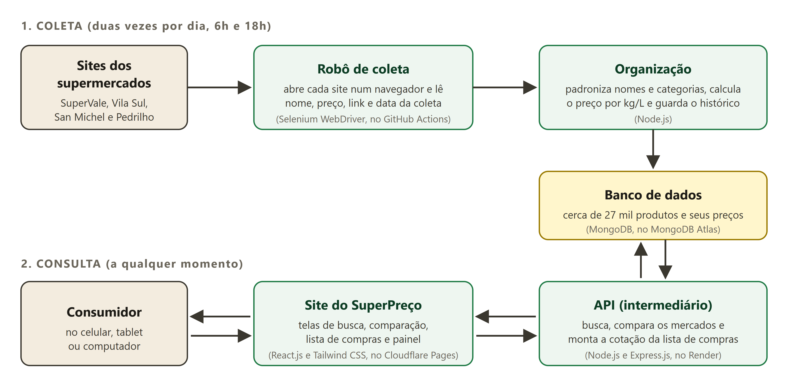
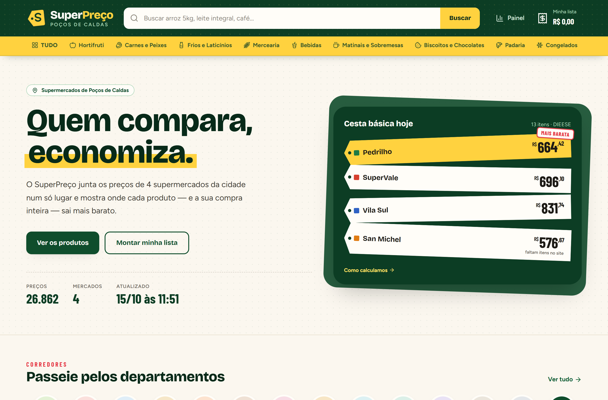
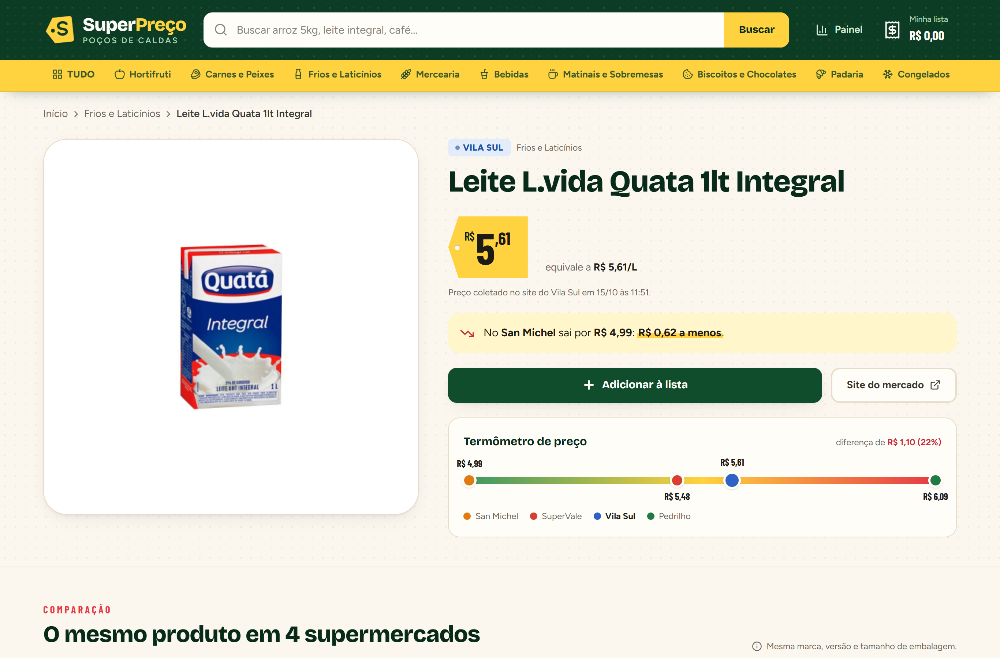
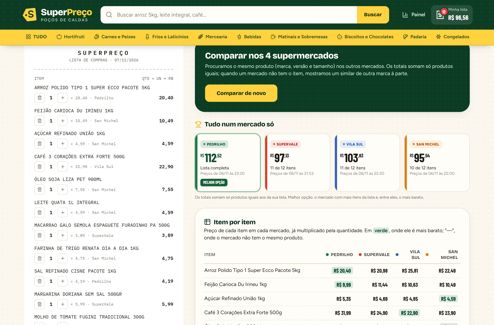
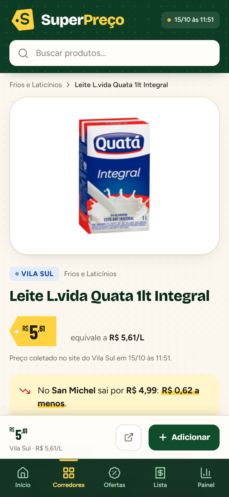
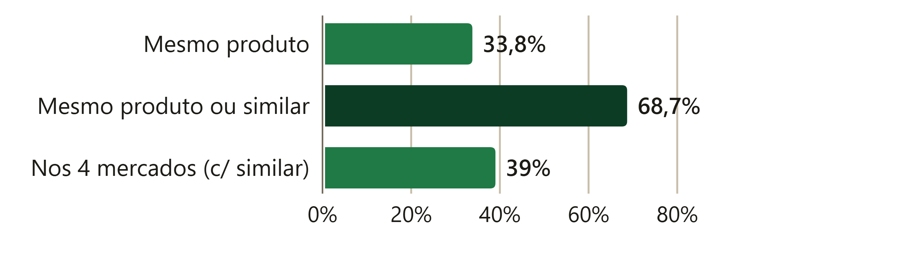
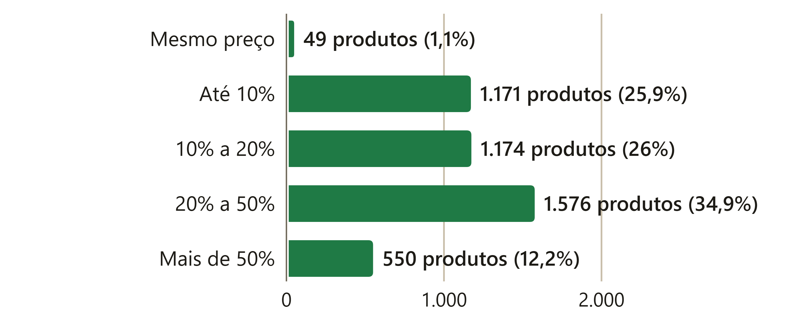
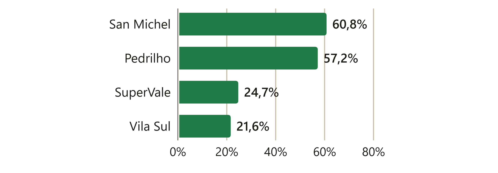
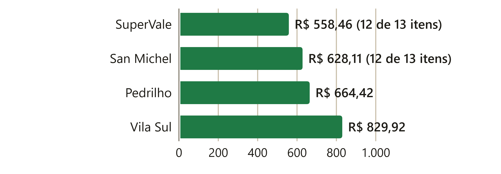

#! RESUMO

A inflação dos alimentos pesa sobretudo no orçamento das famílias de baixa renda, e comparar preços entre supermercados é uma forma eficaz de economizar, mas a consulta manual em vários sites ou lojas exige tempo e esforço. Este trabalho apresenta o SuperPreço, uma aplicação web que reúne os preços de quatro supermercados de Poços de Caldas (MG) e mostra onde cada produto, e a compra inteira, sai mais barato. Os preços são coletados automaticamente duas vezes por dia por um robô que abre os sites dos mercados em um navegador e lê as informações exibidas, técnica conhecida como *web scraping*. O sistema padroniza os nomes dos produtos para reconhecer o mesmo item em sites diferentes e calcula o preço por quilo ou por litro, permitindo comparar embalagens de tamanhos distintos. A plataforma foi desenvolvida com React.js, Node.js, Express.js, MongoDB e Selenium WebDriver e publicada em serviços gratuitos. Foram acompanhados cerca de 27 mil produtos. Apenas 33,8% deles aparecem de forma idêntica em mais de um mercado, índice que sobe para 68,7% quando se consideram produtos similares de outras marcas. Entre os produtos vendidos em mais de um mercado, a diferença entre o maior e o menor preço foi de 18,5% na mediana, e a cesta básica completa chegou a custar R$ 165,50 a mais por mês conforme o supermercado. Em uma conferência manual, a identificação do mesmo produto acertou 88% dos casos. Em uma avaliação com 38 usuários, a ferramenta obteve pontuação média de 87,2 no questionário de usabilidade SUS, e 87% dos participantes disseram que a usariam para planejar suas compras. Os resultados indicam que nenhum supermercado é o mais barato em tudo, reforçando a utilidade da ferramenta.

**Palavras-chave:** Comparação de preços; Supermercados; Web Scraping; Aplicação Web.

# INTRODUÇÃO

A elevação do preço dos alimentos tem impactado diretamente o orçamento das famílias brasileiras, especialmente a população de baixa renda, que destina uma parcela significativa de sua renda a itens essenciais. Nos 12 meses até janeiro de 2025, essa categoria de produtos ficou 7,25% mais cara, em média, superando a inflação geral de 4,56% (KRAMER, 2025). Em um contexto de inflação elevada e insegurança alimentar, mais da metade dos brasileiros reduziu a quantidade de alimentos comprados, o que demonstra a necessidade de estratégias que auxiliem na economia durante as compras (ISTOÉ DINHEIRO, 2025).

Comparar preços entre supermercados é uma dessas estratégias, mas na prática ela dá trabalho. Para saber onde uma lista de compras sai mais barata, o consumidor precisa visitar várias lojas ou abrir o site de cada uma, procurar produto por produto e anotar os valores. Mesmo quando os mercados têm loja virtual, cada site organiza e nomeia os produtos à sua maneira, e embalagens de tamanhos diferentes dificultam saber qual opção é de fato mais econômica.

Diante desse cenário, este trabalho apresenta o SuperPreço, uma aplicação web que reúne em um só lugar os preços de quatro supermercados de Poços de Caldas (MG): SuperVale, Vila Sul, San Michel e Pedrilho. Os preços são coletados automaticamente dos sites desses mercados duas vezes por dia, e o usuário pode buscar um produto e ver quanto ele custa em cada supermercado, encontrar opções parecidas de outras marcas quando um mercado não vende o item procurado, montar uma lista de compras e descobrir em qual mercado ela sai mais barata, além de acompanhar o custo da cesta básica em cada estabelecimento. Todos os preços exibidos informam de qual site vieram e em que data e horário foram coletados.

Este artigo está organizado da seguinte forma: a seção 2 apresenta os conceitos e as tecnologias em que o trabalho se apoia; a seção 3 descreve como o sistema foi construído; a seção 4 apresenta a aplicação desenvolvida e os resultados obtidos com os dados coletados; e a seção 5 traz as considerações finais.

## Objetivos

### Objetivo Geral

Desenvolver uma aplicação web capaz de coletar, armazenar e apresentar, de forma centralizada e com atualização periódica, os preços de produtos alimentícios em diferentes supermercados, utilizando técnicas de web scraping, com o intuito de auxiliar os consumidores na economia de tempo e dinheiro durante suas compras.

### Objetivos Específicos

- Desenvolver uma aplicação web chamada SuperPreço, voltada à comparação de preços de alimentos entre diferentes supermercados;
- Implementar um sistema de web scraping automatizado para coletar dados diretamente dos sites de supermercados selecionados;
- Criar uma interface web responsiva e intuitiva, acessível por diferentes dispositivos, como celulares, tablets e computadores;
- Construir uma API backend que disponibilize os dados de forma segura, rápida e organizada para a aplicação frontend;
- Integrar um banco de dados NoSQL para armazenar os preços coletados de forma estruturada e eficiente;
- Disponibilizar uma interface para a visualização dos preços comparados automaticamente entre os supermercados previamente mapeados pela plataforma.

# FUNDAMENTAÇÃO TEÓRICA

## O preço dos alimentos e a comparação entre supermercados

Segundo a reportagem "Preços de alimentos já sobem quase o dobro da inflação este ano", publicada pelo jornal O Globo (2024), os preços dos alimentos têm crescido em ritmo superior ao da inflação geral. De acordo com a reportagem, o principal motivo foi o clima: o fenômeno El Niño prejudicou as colheitas, e a safra menor encareceu sobretudo os alimentos in natura. Esse cenário reforça a importância de ferramentas que facilitem o acesso a informações de preços e permitam ao consumidor acompanhar melhor as variações do mercado.

Muitos supermercados passaram a vender também pela internet, mas não há padronização na apresentação das informações dos produtos. Um mesmo item pode aparecer com descrições, marcas, pesos, unidades de medida e categorias diferentes em cada site, o que dificulta a comparação manual e exige uma organização mais cuidadosa dos dados. Essa dificuldade é conhecida também na pesquisa acadêmica: ao avaliarem diferentes métodos para identificar registros que representam a mesma coisa, Köpcke, Thor e Rahm (2010) concluíram que reconhecer o mesmo produto em lojas virtuais diferentes é uma das tarefas mais difíceis, e que comparar apenas a semelhança dos textos não resolve bem o problema.

## Web scraping: a coleta automática de informações na internet

Web scraping é uma forma de navegação programada em sites com o objetivo de extrair dados automaticamente por meio de programas que simulam o comportamento de um usuário (TAVARES; CUNHA, 2021). Em vez de uma pessoa abrir cada página e copiar os preços à mão, um programa faz esse trabalho de forma repetitiva e organizada. No caso do SuperPreço, essa técnica permite coletar o nome do produto, o preço, o supermercado de origem, o endereço da página e a data da coleta, dispensando a consulta manual.

Os sites dos supermercados, porém, não entregam a página pronta de uma só vez. Eles montam a vitrine aos poucos enquanto a página é exibida, como acontece quando o usuário rola uma lista e novos produtos aparecem. Por isso, simplesmente baixar o conteúdo inicial de uma página não basta: muitos preços só existem depois que o site termina de carregar. Para esses casos existe o Selenium WebDriver, uma ferramenta que abre o site em um navegador de verdade, controlado por um programa, e permite automatizar ações como abrir páginas, clicar em botões, aguardar o carregamento dos resultados e ler os elementos exibidos na tela (ROMANINI; SOTTO, 2019; SELENIUM, 2025a). Com ele, a coleta enxerga as páginas da mesma forma que um consumidor as veria.

## Como reconhecer o mesmo produto em sites diferentes

Comparar preços pressupõe saber que dois anúncios se referem ao mesmo produto, e isso não é trivial. O mesmo refrigerante aparece como "Refrigerante Coca Cola Pet 2lt" em um site e como "Refrigerante Coca-Cola Garrafa 2l" em outro. Para um leitor humano é claro que se trata do mesmo item; para um programa, são dois textos diferentes.

Uma forma clássica de medir o quanto dois textos se parecem é contar as palavras que eles têm em comum. O coeficiente de Dice (DICE, 1945) faz exatamente isso: compara a quantidade de palavras compartilhadas com o total de palavras dos dois nomes, resultando em um valor entre 0 (nada em comum) e 1 (iguais). No entanto, nem toda palavra tem o mesmo valor para identificar um produto. Palavras que aparecem em milhares de anúncios, como "leite" ou "refrigerante", ajudam pouco a diferenciá-los, enquanto palavras raras, geralmente a marca, são muito mais informativas. Essa ideia, de dar mais peso aos termos menos frequentes, é uma das bases da área de recuperação de informação (SPARCK JONES, 1972) e foi aplicada neste trabalho, como descrito na seção 3.

Outro ponto importante é o tamanho da embalagem. Um pacote de café de 500 g e outro de 250 g não podem ser comparados apenas pelo preço. Por isso, uma comparação justa considera o preço por unidade de medida (por quilo, por litro ou por unidade), que mostra qual opção rende mais pelo valor pago.

## Tecnologias utilizadas no projeto

Uma aplicação web como o SuperPreço é formada por partes com funções diferentes, que trabalham em conjunto. A parte que o usuário vê, chamada de *frontend*, é o próprio site, com as telas de busca, comparação e lista de compras. Por trás dele há o *backend*, que guarda os dados e faz os cálculos, e a comunicação entre as duas partes acontece por meio de uma API (Interface de Programação de Aplicações), que funciona como um intermediário: o site faz um pedido, por exemplo "os preços deste produto nos outros mercados", e a API devolve a resposta organizada. A Tabela 1 resume o papel de cada parte e a ferramenta escolhida para ela.

Tabela 1. Partes do sistema e ferramentas utilizadas

| Parte do sistema | O que faz no SuperPreço | Ferramenta |
| --- | --- | --- |
| Site (frontend) | Mostra os produtos, a comparação entre mercados e a lista de compras | React.js e Tailwind CSS |
| API (backend) | Recebe os pedidos do site, consulta o banco e devolve os resultados | Node.js e Express.js |
| Banco de dados | Guarda os produtos, os preços e o histórico de preços | MongoDB, com Mongoose |
| Coleta | Abre os sites dos mercados e lê os preços exibidos | Selenium WebDriver |
| Agendamento | Repete a coleta em horários fixos, sem intervenção manual | node-cron e GitHub Actions |

Fonte: elaborada pelo autor.

O React.js é uma biblioteca para construir interfaces a partir de componentes, que são pedaços de tela reaproveitáveis, como a barra de busca, o cartão de um produto ou a etiqueta de preço. Essa organização facilita a manutenção e permite que a tela seja atualizada assim que novos dados chegam (NEVES, 2023; META, 2025). A aparência foi construída com o Tailwind CSS, que oferece classes de estilo prontas e facilita a criação de telas que se adaptam a celulares, tablets e computadores (TAILWIND LABS, 2025).

No backend, o Node.js permite executar JavaScript, a linguagem mais usada na construção de sites (MOZILLA DEVELOPER NETWORK, 2025), também no servidor, de modo que a mesma linguagem foi usada no site, na API e no robô de coleta (NODE.JS FOUNDATION, 2025). Em conjunto com o Express.js, ele organiza os endereços (rotas) que o site pode consultar e as respostas que cada um devolve (MOZILLA, 2023; EXPRESS.JS, 2025).

Para armazenar os dados foi usado o MongoDB, um banco de dados NoSQL que guarda as informações em documentos flexíveis, parecidos com fichas, em vez de tabelas rígidas. Essa flexibilidade é útil porque cada supermercado apresenta seus produtos de forma diferente: alguns informam preço "de" e "por", outros vendem itens a granel, outros trazem o peso apenas no nome. O Mongoose foi usado para definir o formato esperado de cada documento e manter as informações consistentes (MONGODB INC., 2025; MONGOOSE, 2025).

## Ferramentas existentes

Existem algumas soluções no mercado que buscam atender à necessidade de comparação de preços, mas a maioria delas é voltada a produtos eletrônicos, eletrodomésticos e passagens aéreas. Dentre os principais exemplos estão:

- **Buscapé**: plataforma conhecida no Brasil para comparação de preços, com foco principal em eletrônicos e eletrodomésticos. Apesar de sua popularidade, não oferece suporte efetivo para itens de supermercado, especialmente alimentos (BUSCAPÉ, 2025).
- **Zoom**: semelhante ao Buscapé, permite comparar preços e acompanhar ofertas, mas sua atuação também se restringe, em grande parte, a produtos de tecnologia, e a presença de itens alimentícios é limitada (ZOOM, 2025).
- **Google Shopping**: possui uma cobertura mais ampla de categorias, mas a atualização dos preços de alimentos e a presença de supermercados regionais ainda são insuficientes para atender às demandas locais dos consumidores (GOOGLE, 2025).

Nenhuma dessas soluções oferece uma cobertura de preços de alimentos com atualização periódica nos supermercados de uma cidade como Poços de Caldas. O SuperPreço se propõe a preencher essa lacuna com uma solução focada nesse tipo de produto e na realidade de consumidores que fazem compras em estabelecimentos locais.

# METODOLOGIA

O desenvolvimento foi organizado em etapas, conforme o cronograma do projeto: levantamento de requisitos, definição da arquitetura, construção da coleta de dados, do banco de dados, da API e do site, testes, publicação na internet e, por fim, análise dos dados coletados. A Figura 1 resume o caminho que um preço percorre no sistema, desde o site do supermercado até a tela do consumidor, e serve de guia para as subseções seguintes.

Fonte: elaborada pelo autor.

## Levantamento de requisitos

O levantamento de requisitos consistiu em identificar as necessidades dos usuários relacionadas à dificuldade de acompanhar e comparar preços de produtos alimentícios em diferentes supermercados. A partir dessa análise, foram definidas as funcionalidades essenciais (requisitos funcionais): busca por produto, visualização de preços por estabelecimento, comparação entre mercados, exibição da data da coleta e adaptação da interface para dispositivos móveis. Também foram considerados requisitos não funcionais, que dizem respeito à qualidade do sistema e não a uma tela específica: usabilidade, organização dos dados, tempo de resposta da API, segurança e possibilidade de expansão para novos supermercados.

## Escolha dos supermercados

Foram escolhidos supermercados de Poços de Caldas que mantêm loja virtual com preços visíveis ao público. Os quatro selecionados usam duas plataformas de comércio eletrônico diferentes, como mostra a Tabela 2. Isso foi aproveitado na construção da coleta: como os três mercados da mesma plataforma têm páginas organizadas da mesma forma, um único conjunto de instruções serve para todos eles, e um novo supermercado que use uma dessas plataformas pode ser incluído apenas com o cadastro do seu endereço na internet.

Tabela 2. Supermercados acompanhados pelo SuperPreço

| Supermercado | Plataforma da loja virtual | Unidade conferida na coleta |
| --- | --- | --- |
| SuperVale | VipCommerce | Av. João Pinheiro, 1460 |
| Vila Sul | VipCommerce | Av. Sílvio Monteiro dos Santos, 180 |
| San Michel | VipCommerce | Av. Mansur Frayha, 875 |
| Pedrilho | iBecom | R. José Augusto de Carvalho, 55 |

Fonte: elaborada pelo autor.

Algumas dessas redes têm lojas em outras cidades, e os preços podem variar de uma unidade para outra. Para não misturar preços de lojas diferentes, antes de cada coleta o robô confere se a página exibe o endereço da unidade de Poços de Caldas e interrompe a coleta caso apareça outra loja.

## Coleta automática dos preços

A coleta foi construída com o Selenium WebDriver em JavaScript (SELENIUM, 2025b). Para cada supermercado, o robô abre a página inicial, descobre a lista de departamentos (Hortifruti, Mercearia, Bebidas e assim por diante) e percorre cada um deles. Nos sites da plataforma VipCommerce, os produtos são divididos em páginas numeradas, e o robô avança de página em página até que não apareçam produtos novos. No Pedrilho, a vitrine carrega mais produtos à medida que a página é rolada, então o robô rola a página até o fim, como um usuário faria. Em cada produto exibido, são lidos o nome, o preço atual, o preço anterior quando há oferta, a unidade de venda, a imagem e o endereço da página do produto.

Optou-se por ler apenas as informações que o site mostra na tela. As plataformas de comércio eletrônico também possuem serviços internos que alimentam suas páginas, mas utilizá-los fugiria da proposta de web scraping e dependeria de recursos que não são oferecidos ao público. Ler a página como ela é exibida garante que o preço guardado é o mesmo que o consumidor encontra ao visitar o site.

Alguns cuidados foram necessários para que a coleta fosse confiável. Quando uma página demora a carregar, o robô tenta novamente até três vezes antes de desistir dela. Entre uma página e outra há uma pequena pausa, para não sobrecarregar os sites dos mercados. Por fim, se uma coleta trouxer muito menos produtos que o normal, o que costuma indicar um problema no site naquele momento, os produtos que não apareceram não são removidos da comparação, e o sistema mantém o último preço conhecido.

## Organização e comparação dos produtos

Depois de coletados, os nomes dos produtos passam por uma padronização: letras maiúsculas e acentos são uniformizados, abreviações comuns são expandidas ("refrig." vira "refrigerante", "s/" vira "sem") e o tamanho da embalagem é identificado no nome ("2l", "500g", "12x350ml"). Com o tamanho, o sistema calcula o preço por quilo, por litro ou por unidade de cada produto. Também são identificadas as palavras que indicam versões diferentes de um mesmo produto, como "zero", "integral", "sem lactose", os sabores e os tipos ("feijão preto" e "feijão carioca", "vinho tinto" e "vinho branco"). Palavras que descrevem apenas a embalagem, como "pacote", "copo" ou "sachê", são ignoradas, porque cada site as usa de um jeito.

Dois produtos de mercados diferentes são considerados o mesmo produto quando três condições são atendidas: os nomes são suficientemente parecidos, as versões são iguais e o tamanho da embalagem difere no máximo 2%. A semelhança dos nomes é medida pelo coeficiente de Dice, apresentado na seção 2, com um peso maior para as palavras raras, de modo que a marca conte mais que palavras genéricas. Foram considerados iguais os pares com semelhança de pelo menos 0,6, valor ajustado durante os testes com os dados reais.

A semelhança dos nomes, sozinha, não impede que marcas diferentes sejam confundidas quando o restante do nome é idêntico, como em "Requeijão Cremoso Nestlé" e "Requeijão Cremoso Danone". Por isso, foi montado um dicionário com cerca de 380 marcas, a partir das palavras mais frequentes dos catálogos, revisadas uma a uma pelo autor. Se os dois nomes trazem marcas conhecidas e nenhuma delas coincide, os produtos nunca são considerados iguais. Os nomes de fabricantes, como Nestlé e Danone, recebem um tratamento à parte, porque alguns sites os incluem no nome e outros não: "Biscoito Nestlé Negresco" e "Biscoito Negresco" são o mesmo produto. Outras regras tratam de casos que a semelhança dos nomes não distingue: um kit, como xampu e condicionador vendidos juntos, nunca é igual ao produto avulso; sabores escritos depois do tipo do produto, como em "caldo de carne" e "caldo de galinha", contam como versões diferentes; e, no papel higiênico, o número de rolos precisa coincidir.

Logo nas primeiras análises percebeu-se que muitos produtos não têm um equivalente exato nos outros mercados, porque cada rede trabalha com marcas e tamanhos diferentes. Para que o consumidor não fique sem alternativa, foi criada a sugestão de produtos similares: itens do mesmo tipo e departamento, de outra marca, com tamanho até 25% diferente, ordenados pelo preço por quilo ou por litro. Assim, se um mercado não vende o feijão carioca de determinada marca, o SuperPreço mostra o feijão carioca de outra marca que custa menos por quilo, mas nunca um feijão preto no lugar dele. Para que o tipo do produto seja respeitado, nomes compostos como "batata doce", "pão de forma" e "pão francês" são tratados como um termo único, e o candidato precisa ter a mesma palavra principal do produto original. Assim, a carne bovina moída não é substituída por carne suína, a batata inglesa por batata doce, nem a manteiga por margarina. Essas regras surgiram de um teste com os itens da cesta básica, no qual a primeira versão sugeriu, por exemplo, orelha suína no lugar de carne bovina moída, pão de forma no lugar de pão francês e banana nanica no lugar de banana prata.

Essas duas formas de comparação são usadas na lista de compras, mas separadas, para que o usuário saiba exatamente o que está sendo comparado. Na primeira versão, o similar entrava no total de cada mercado no lugar do item que faltava, e não ficava claro se os totais se referiam aos mesmos produtos; por isso, a comparação foi refeita. Os totais de cada supermercado somam apenas os produtos iguais aos da lista e informam quantos itens o mercado tem. O mercado indicado como melhor opção para fazer toda a compra num lugar só é o que tem mais itens da lista e, entre esses, o de menor total, para que um mercado não pareça mais barato apenas por não vender parte dos produtos. Uma tabela mostra o preço de cada item em cada mercado, destacando o mais barato, e o valor da chamada compra dividida, com cada item comprado onde está mais barato. Uma segunda tabela completa a lista de cada mercado com o similar mais barato de outra marca, destacado, no lugar dos itens que faltam, e traz o total da lista completa. Itens vendidos a peso, como frutas e legumes, são calculados pelo preço por quilo. Com a mesma lógica é calculado o custo da cesta básica em cada mercado, usando os 13 itens e as quantidades mensais de referência do DIEESE para a região Sudeste (BRASIL, 1938; DIEESE, 2026).

## Armazenamento dos dados

Os dados são guardados no MongoDB. Para cada produto são armazenados o nome, o preço, o preço anterior (quando há oferta), o supermercado, o endereço da página no site do mercado, a data e o horário da coleta e os dados calculados na padronização, como a categoria, o tamanho da embalagem e o preço por unidade. Sempre que o preço de um produto muda entre uma coleta e outra, o novo valor é registrado em um histórico, o que permite mostrar ao usuário um gráfico com a evolução do preço ao longo do tempo. Os departamentos de cada mercado, que têm nomes diferentes em cada site, foram reunidos em 13 categorias padronizadas, como Hortifruti, Mercearia e Frios e Laticínios.

## API e segurança

A API foi construída com Node.js e Express.js e oferece ao site os serviços necessários: busca de produtos com filtros, detalhes de um produto, comparação com os outros mercados, sugestão de similares, histórico de preços, cotação da lista de compras, cesta básica e um painel com estatísticas da coleta. Todas as respostas são devolvidas em um formato padronizado, e as rotas foram documentadas para facilitar a manutenção.

Como o sistema está aberto na internet, foram adotadas medidas para protegê-lo de uso indevido. Cada visitante pode fazer um número limitado de consultas por minuto, o que impede que um único computador sobrecarregue o serviço. Os dados enviados ao sistema são conferidos antes de serem usados, de modo que valores inválidos são recusados com uma mensagem clara em vez de causar erros. A API também envia ao navegador instruções de segurança padronizadas e só aceita chamadas vindas do endereço oficial do site.

## Interface do usuário

O site foi construído com React.js e Tailwind CSS. A identidade visual foi inspirada nos encartes de supermercado, com preços em etiquetas amarelas e cores próximas às usadas no varejo, para que o usuário se sinta em um ambiente familiar. As principais telas são a página inicial, a busca de produtos por departamento, a página de cada produto com a comparação entre os mercados, a lista de compras e o painel com informações da coleta. Em vez de apenas encolher a versão de computador, foram criadas versões próprias para celular e para tablet, com navegação por botões na parte inferior da tela no celular, onde o uso com uma mão só é mais comum.

## Atualização periódica e publicação

Para que os preços fiquem atualizados sem intervenção manual, a coleta é executada automaticamente às 6h e às 18h. No código, esse agendamento é feito pela biblioteca node-cron, que dispara a coleta nos horários configurados enquanto o servidor estiver ligado (MERENCIA, 2025).

Para tornar o SuperPreço acessível pela internet sem custos, o sistema foi distribuído em serviços com planos gratuitos. O site está no Cloudflare Pages, a API no Render e o banco de dados no MongoDB Atlas, em um servidor localizado em São Paulo (CLOUDFLARE, 2026; RENDER, 2026; MONGODB INC., 2026). Como o plano gratuito do Render não permite executar um navegador, a coleta passou a ser executada pelo GitHub Actions, um serviço que roda tarefas programadas em computadores na nuvem (GITHUB, 2026). A coleta foi agendada nele para os mesmos horários; ele coleta os quatro supermercados em paralelo e grava os preços no mesmo banco de dados usado pela API. Dessa forma, a atualização acontece mesmo com o computador do desenvolvedor desligado. No plano gratuito, porém, o GitHub Actions não garante o horário exato das tarefas agendadas: nas 30 execuções mais recentes, a coleta começou, na mediana, cerca de 4 horas e 20 minutos depois do horário programado (de 1h51 a 10h06 de atraso), mas sempre duas vezes por dia.

## Testes e avaliação

Foram escritos 87 testes automatizados, que verificam o funcionamento do sistema a cada alteração no código. Eles cobrem a padronização dos nomes, as regras de comparação e de similares, a importação dos dados, as respostas da API, as medidas de segurança e os cálculos da análise de dados. Para testar o robô de coleta sem depender dos sites dos mercados, foram salvas cópias de trechos reais das páginas do SuperVale e do Pedrilho; o robô abre essas cópias em um navegador e os testes conferem se ele leu corretamente preços, ofertas, unidades e produtos sem estoque.

A avaliação dos resultados foi feita de três formas. Primeiro, foi desenvolvido um programa de análise que percorre todos os produtos do banco de dados e calcula quantos podem ser comparados entre os mercados, quanto os preços variam e quanto custam a cesta básica e uma lista de compras de exemplo em cada supermercado. Segundo, para medir a confiabilidade da comparação, 50 pares de produtos considerados iguais pelo sistema foram sorteados e conferidos manualmente pelo autor, que anotou se cada par era de fato o mesmo produto. Terceiro, foi aplicada uma avaliação com usuários por meio de um questionário on-line (Google Forms), respondido de forma voluntária e anônima. Cada participante usou o SuperPreço publicado para cumprir duas tarefas curtas, descobrir em qual mercado um produto de marca estava mais barato e qual mercado tinha a cesta básica mais barata, e informou quanto tempo levou em cada uma e quanto tempo acredita que levaria sem a ferramenta. Em seguida, respondeu ao *System Usability Scale* (SUS), um questionário padronizado de dez afirmações com notas de 1 a 5 que resulta em uma pontuação de 0 a 100 para a facilidade de uso (BROOKE, 1996), além de três perguntas sobre economia, confiança nos preços e intenção de uso e de um campo livre para comentários. Os resultados estão na seção 4.8.

# RESULTADOS E DISCUSSÃO

## A aplicação desenvolvida

O SuperPreço está publicado e pode ser acessado pelo navegador de qualquer computador ou celular. A página inicial (Figura 2) apresenta a proposta da ferramenta, a quantidade de preços acompanhados, a data da última atualização e o custo da cesta básica em cada supermercado, destacando o mais barato.

Fonte: elaborada pelo autor.

Ao abrir um produto (Figura 3), o usuário vê o preço no mercado escolhido, o preço por litro ou por quilo, a data e o horário em que o valor foi coletado e um aviso quando o mesmo produto está mais barato em outro supermercado. Logo abaixo, um "termômetro de preço" posiciona os mercados que vendem o produto do mais barato ao mais caro, indicando também os que não o vendem, e um quadro lista o preço do produto em cada um deles. Na mesma página aparecem as opções de outras marcas mais baratas por litro ou por quilo e o histórico de preços do item.

Fonte: elaborada pelo autor.

A lista de compras (Figura 4) é a funcionalidade que mais se aproxima do uso cotidiano. O usuário adiciona os produtos que pretende comprar e, ao pedir a comparação, vê três blocos. O primeiro mostra o total em cada supermercado, somando só os produtos iguais aos da lista, quantos itens cada mercado tem e a data dos preços, e destaca como melhor opção o mercado com mais itens da lista e, entre eles, o mais barato. O segundo é uma tabela com o preço de cada item em cada mercado, com o mais barato em destaque e o valor da compra dividida. O terceiro completa a lista de cada mercado com similares de outras marcas, destacados, e mostra o total da lista inteira. A lista fica salva no próprio aparelho, sem necessidade de cadastro.

Fonte: elaborada pelo autor.

A versão para celular (Figura 5) reorganiza as mesmas informações em uma coluna, mantém o preço e o botão de adicionar à lista sempre visíveis na parte inferior da tela e oferece um menu de navegação ao alcance do polegar.

Fonte: elaborada pelo autor.

## Dados coletados

Na coleta analisada, de 6 de novembro de 2026, o SuperPreço reunia 26.974 produtos disponíveis nos quatro supermercados, dos quais cerca de 61% são alimentos e bebidas. A Tabela 3 mostra a distribuição por mercado. A diferença de tamanho entre os catálogos é grande: o Pedrilho e o Vila Sul oferecem quase três vezes mais produtos em seus sites que o SuperVale.

Tabela 3. Produtos disponíveis por supermercado

| Supermercado | Produtos | Alimentos e bebidas | Em oferta | Tempo de coleta |
| --- | ---: | ---: | ---: | ---: |
| Pedrilho | 9.490 | 5.468 | 0 | 46 min |
| Vila Sul | 9.196 | 5.897 | 401 | 52 min |
| San Michel | 4.974 | 3.098 | 166 | 29 min |
| SuperVale | 3.314 | 2.122 | 196 | 21 min |
| **Total** | **26.974** | **16.585** | **763** | **cerca de 52 min** |

Fonte: dados coletados pelo SuperPreço (2026).

Os tempos da tabela são a mediana das coletas no GitHub Actions. Como os quatro supermercados são coletados ao mesmo tempo, uma atualização completa leva cerca de 52 minutos, o tempo do mercado mais demorado. Nas 30 execuções agendadas mais recentes, todas as 120 coletas de mercado (30 para cada supermercado) foram concluídas com sucesso.

Entre 15 de outubro e 7 de novembro de 2026, o histórico registrou 4.206 mudanças de preço em 2.406 produtos, sendo 2.749 altas e 1.457 quedas, com variação típica de cerca de 20% (mediana de 22,2% nas altas e de 19,2% nas quedas). Parte dessas mudanças não corresponde a remarcações reais: uma lata de cerveja, por exemplo, alternou várias vezes entre o preço da unidade e o preço do fardo no site do mercado. Por isso, o período ainda é curto para conclusões sobre a evolução dos preços, mas já mostra que os valores mudam com frequência e reforça a importância da atualização periódica.

## Quanto os produtos podem ser comparados

Um dos resultados mais relevantes do trabalho é que comparar o mesmo produto entre supermercados é possível em apenas parte dos casos. Somente 33,8% dos produtos aparecem de forma idêntica, com mesma marca, versão e tamanho, em pelo menos um outro mercado (Figura 6). Isso acontece porque cada rede tem fornecedores, marcas próprias e tamanhos de embalagem diferentes, e porque os catálogos têm tamanhos muito distintos.

Ao considerar os produtos similares de outras marcas, esse índice sobe para 68,7%, e 39,0% dos produtos passam a ter um equivalente ou um similar em todos os quatro supermercados. Essa diferença justifica a decisão, tomada durante o desenvolvimento, de não limitar a comparação a produtos idênticos: sem os similares, a lista de compras ficaria incompleta na maioria dos mercados.

Fonte: dados coletados pelo SuperPreço (2026).

## Diferenças de preço entre os supermercados

Foram encontrados 4.520 produtos vendidos de forma idêntica em mais de um supermercado. Para cada um deles, calculou-se a diferença entre o maior e o menor preço. Na mediana, essa diferença foi de 18,5%, ou seja, em metade dos produtos o mercado mais caro cobra até 18,5% a mais que o mais barato, e na outra metade a diferença é ainda maior. Em 47% dos produtos a diferença passa de 20%, e apenas 49 produtos (1,1%) tinham o mesmo preço em todos os mercados onde aparecem (Figura 7). Em valores absolutos, a diferença média foi de R$ 2,54 por produto.

Fonte: dados coletados pelo SuperPreço (2026).

Para não distorcer esses números, foram deixados de fora 78 produtos em que o preço mais alto era mais que o triplo do mais baixo. A análise desses casos mostrou que, quase sempre, não se tratava de diferenças reais, e sim de erros de cadastro nos próprios sites, como uma lata de cerveja anunciada com o preço de um fardo, ou de produtos diferentes que o sistema identificou como iguais.

A Figura 8 mostra com que frequência cada supermercado tem o menor preço quando o mesmo produto está em mais de um mercado. O San Michel foi o mais barato em 60,8% das comparações em que aparece e o Pedrilho em 57,2%, enquanto o SuperVale (24,7%) e o Vila Sul (21,6%) ficaram atrás. Ainda assim, nenhum mercado é o mais barato em tudo: mesmo o Vila Sul, o que menos vezes tem o menor preço, é o mais em conta em centenas de produtos, e a liderança muda conforme o departamento. O Pedrilho foi o mais barato com mais frequência em Bebidas, Limpeza e Hortifruti, por exemplo, e o San Michel em Mercearia, Higiene e Frios e Laticínios. É justamente essa variação que torna difícil, para o consumidor, saber de antemão onde comprar, e que dá sentido a uma ferramenta de comparação.

Fonte: dados coletados pelo SuperPreço (2026).

## Cesta básica e lista de compras

A Figura 9 apresenta o custo da cesta básica, com os 13 itens e as quantidades mensais de referência do DIEESE, montada com o produto de menor preço por quilo ou por litro de cada item em cada supermercado. Entre os mercados que vendem todos os itens no site, o Pedrilho teve a cesta mais barata (R$ 664,42) e o Vila Sul a mais cara (R$ 829,92). A diferença, de R$ 165,50 por mês, equivale a 24,9% e, ao longo de um ano, chega a quase dois mil reais. O SuperVale (R$ 558,46) e o San Michel (R$ 628,11) apresentaram totais menores, mas não puderam entrar na comparação porque faltava um item em cada site: o tomate no SuperVale e o pão francês no San Michel.

Fonte: dados coletados pelo SuperPreço (2026).

Para simular uma compra comum, foi montada uma lista com 12 itens básicos de mercearia, como arroz, feijão, açúcar, café, óleo, leite e macarrão. Para cada item foi escolhido o produto de marca vendido no maior número de mercados. A Tabela 4 mostra o resultado. Mesmo com essa escolha, só o Pedrilho vendia os 12 produtos, e ele foi justamente o mais caro (R$ 112,52). Nos outros três mercados faltavam um ou dois itens, como o molho de tomate e o achocolatado da marca escolhida. Completando a lista com o similar mais barato de outra marca, o total variou de R$ 103,92 no SuperVale a R$ 112,52 no Pedrilho. Comprando cada item no mercado onde o mesmo produto estava mais barato, o total cairia para R$ 96,06, R$ 7,86 a menos que no SuperVale. Na prática, dividir a compra exige ir a mais de uma loja, e cabe ao consumidor avaliar se a economia compensa o deslocamento; o SuperPreço apenas torna essa informação visível.

Tabela 4. Total da lista de compras de exemplo (12 itens) em cada supermercado

| Supermercado | Só produtos iguais | Itens iguais encontrados | Lista completa, com similares | Itens trocados por similar |
| --- | ---: | ---: | ---: | ---: |
| SuperVale | R$ 97,13 | 11 | R$ 103,92 | 1 |
| San Michel | R$ 95,54 | 10 | R$ 108,13 | 2 |
| Vila Sul | R$ 103,83 | 11 | R$ 109,42 | 1 |
| Pedrilho | R$ 112,52 | 12 | R$ 112,52 | 0 |
| Compra dividida (cada item no mais barato) | R$ 96,06 | 12 | — | — |

Fonte: dados coletados pelo SuperPreço (2026).

Os resultados da cesta básica e da lista de compras apontam mercados diferentes como os mais baratos, o que reforça a conclusão anterior: o mercado mais em conta depende do que se compra. Mostram também por que a lista separa os produtos iguais dos similares: somar só os iguais faria o San Michel parecer o mais barato, quando na verdade faltam dois itens da lista nele.

## Confiabilidade da comparação

Na conferência manual dos 50 pares sorteados, 44 eram de fato o mesmo produto, o que corresponde a uma precisão de 88%. Os seis erros encontrados ajudam a entender os limites do método. Três deles envolviam versões diferentes de um mesmo produto, como uma Coca-Cola comum e a Coca-Cola Plus Café, ou um biscoito de chocolate e outro de chocolate com avelã. Os demais confundiram um kit de xampu e condicionador com o condicionador avulso, uma embalagem com duas escovas de dente com outra com apenas uma, e uma cerveja em garrafa de 355 ml com a mesma cerveja em lata de 350 ml. Em todos os casos, a palavra que diferencia os produtos ("plus", "avelã", "kit", "2 unidades", "garrafa") tinha pouco peso no cálculo de semelhança dos nomes. O caso do kit foi corrigido na revisão descrita a seguir, e os demais apontam um caminho claro para melhorias.

A análise também revelou problemas que foram corrigidos ao longo do trabalho. Produtos vendidos a granel, com preço por quilo, chegaram a ser comparados com produtos embalados, e pacotes promocionais do tipo "leve 12, pague 10" eram tratados como se fossem uma unidade. Ambos os casos foram identificados pelas diferenças de preço anormais que geravam e passaram a ser tratados corretamente.

Após essa conferência, as regras de comparação foram revisadas com o dicionário de marcas, o tratamento de kits, de sabores e do número de rolos, descritos na seção 3. A revisão partiu de casos em que o mesmo produto não era reconhecido porque os sites escrevem o nome de formas diferentes, como "Instantâneo" e "Ins.", ou "Squeeze" e "Copo". Aplicadas à base de 26.825 produtos, as novas regras eliminaram 367 pares, em sua grande maioria comparações erradas que já existiam, como requeijões de marcas diferentes considerados iguais, caldo de carne igualado ao de galinha e kits de xampu e condicionador igualados ao xampu avulso. Também acrescentaram 79 pares, quase todos corretos, de produtos que antes não eram reconhecidos por diferenças na escrita dos nomes. O número de produtos com equivalente em outro mercado praticamente não mudou (de 34,5% para 34,1%), mas a avaliação dos pares que saíram e entraram, feita pelo autor, indica que a precisão aumentou.

## Desempenho e dificuldades encontradas

O tempo de resposta da API foi medido no servidor publicado. Com o serviço em funcionamento, as consultas levaram entre 0,15 e 0,49 segundo na mediana, sendo a busca de produtos e a cotação da lista de compras as mais demoradas. A medição mostrou que o cálculo da cesta básica levava cerca de 3,8 segundos, porque era refeito a cada visita; como os preços só mudam a cada coleta, o resultado passou a ser guardado por alguns minutos, e o tempo caiu para 0,15 segundo. No plano gratuito do Render, o servidor é desligado após 15 minutos sem uso, e a primeira consulta seguinte pode levar perto de um minuto para ser respondida, uma limitação aceitável para um projeto acadêmico.

Durante o desenvolvimento, algumas dificuldades exigiram ajustes na coleta. Em produtos vendidos em bandeja, como carnes e frios, os sites mostram dois preços: o valor cobrado pela embalagem (por exemplo, R$ 48,93 por um salame de 700 g) e o preço por quilo apenas como informação (R$ 69,90/kg). Inicialmente, o robô guardava o preço por quilo como se fosse o preço do produto, o que afetava cerca de 560 itens. O erro foi percebido ao comparar os preços do SuperPreço com os do site do mercado e foi corrigido para que o robô leia o valor efetivamente cobrado. Outro caso ocorreu quando um dos supermercados passou a exibir banners promocionais na página inicial, que carregavam antes do menu de departamentos e confundiram o robô; a coleta passou a esperar o menu completo e ganhou a proteção, descrita na seção 3, contra coletas incompletas. Esses episódios mostram uma característica própria do web scraping: como a coleta depende da forma como os sites são montados, qualquer mudança feita pelos supermercados pode exigir adaptações, e por isso os testes automatizados com cópias das páginas reais se mostraram importantes.

## Avaliação com usuários

O questionário recebeu 38 respostas, entre 19 e 20 de outubro de 2026, todas com o aceite de participação. A maioria dos participantes tinha de 25 a 39 anos (47%) ou até 24 anos (39%), e os demais, de 40 a 59 anos (13%). Quase dois terços (63%) responderam pelo celular. Sobre o hábito de comparar preços, 71% disseram fazer isso às vezes, 18% sempre e 11% nunca, o que mostra que a comparação já faz parte da rotina de compras, mas não de forma sistemática.

**Facilidade de uso.** O SuperPreço obteve pontuação SUS média de 87,2 (mediana de 95,0; desvio-padrão de 14,9). O valor fica bem acima de 68, considerado a média de referência do questionário (SAURO, 2011), e corresponde à faixa "excelente" na escala de adjetivos proposta por Bangor, Kortum e Miller (2009). Das 38 pontuações, 32 (84%) ficaram acima de 68, e apenas uma ficou abaixo de 51. As afirmações positivas receberam notas médias entre 4,3 e 4,6, e as negativas, entre 1,4 e 1,7. A menor média positiva foi a de "achei o sistema fácil de usar" (4,34), e a afirmação negativa mais pontuada foi "achei o sistema desnecessariamente complexo" (1,68), o que indica que a interface pode ser simplificada. A pontuação foi praticamente a mesma no celular (87,1) e no computador (87,5), o que sugere que a adaptação da interface para telas pequenas cumpriu seu papel.

**Tarefas.** A Tabela 5 resume as respostas. Na primeira tarefa, 63% dos participantes indicaram corretamente o San Michel como o mercado com o café 3 Corações tradicional de 500 g mais barato naquele dia (R$ 23,90, contra R$ 26,49 no SuperVale, R$ 27,39 no Vila Sul e R$ 31,99 no Pedrilho). O erro mais comum, apontar o SuperVale (24%), provavelmente se deve ao fato de esse mercado vender outras versões do mesmo café, como a Extra Forte, por preços menores, que aparecem na mesma busca. Na segunda tarefa, metade dos participantes identificou o Pedrilho como o mercado com a cesta básica mais barata, e 21% não conseguiram encontrar a informação. Parte dos erros pode estar ligada ao San Michel, que tem o menor total, mas fica fora da comparação por não vender todos os itens no site. Em ambas as tarefas, a maioria disse ter levado menos de um minuto, e quase todos, no máximo três minutos.

Tabela 5. Resultados das tarefas da avaliação com usuários (38 participantes)

| Tarefa | Acertos | Não conseguiram | Levaram menos de 1 min | Levaram até 3 min |
| --- | ---: | ---: | ---: | ---: |
| Café 3 Corações tradicional 500 g mais barato | 24 (63%) | 3 (8%) | 25 (66%) | 37 (97%) |
| Mercado com a cesta básica mais barata | 19 (50%) | 8 (21%) | 19 (50%) | 36 (95%) |

Fonte: dados da pesquisa (2026).

**Tempo sem a ferramenta.** Perguntados quanto tempo levariam para descobrir as mesmas informações olhando os sites ou indo aos mercados, 42% responderam mais de 15 minutos (29% mais de 30 minutos), 24% de 5 a 15 minutos e apenas 5% menos de 5 minutos. Outros 29% afirmaram que simplesmente não fariam essa comparação. Embora esses tempos sejam percebidos pelos participantes, e não cronometrados, a diferença entre "até três minutos" com o SuperPreço e "mais de 15 minutos" sem ele indica que a ferramenta reduz o tempo da pesquisa de preços, como proposto no objetivo geral, e que, para quase um terço das pessoas, ela torna possível uma comparação que não seria feita.

**Percepção de utilidade.** Para 95% dos participantes, o SuperPreço os ajudaria a economizar nas compras (74% deram nota 5 e 21% nota 4), e os demais 5% ficaram neutros. Sobre confiar nos preços por saber a data da coleta, 92% concordaram e 8% ficaram neutros. Quanto ao uso, 87% disseram que usariam o SuperPreço para planejar as compras, e 13% responderam "talvez"; nenhum participante respondeu "não".

**Comentários.** Dos 15 participantes que deixaram comentários, vários elogiaram a facilidade de uso e a rapidez para encontrar produtos, e um deles disse que indicaria o site para a família. As sugestões se concentraram em quatro pontos: tornar a cesta básica mais fácil de encontrar, com um item próprio no menu (três participantes); incluir mais supermercados da cidade (dois); mostrar o menor preço já na página de busca e simplificar a quantidade de informações na tela; e explicar melhor como os preços são coletados, já que o preço da loja física pode ser diferente do preço do site. Um participante relatou um caso em que o mesmo leite condensado não foi reconhecido no Pedrilho, o que confirma o limite de identificação apontado na seção 4.6, e outro sugeriu um aplicativo para celular.

Esses resultados devem ser lidos com cautela. A amostra é pequena e de conveniência, formada por pessoas próximas ao autor, o que tende a elevar as notas, e os tempos foram informados pelos próprios participantes. Ainda assim, a pontuação SUS alta, a taxa de acerto da maioria nas tarefas e a intenção de uso declarada indicam que o SuperPreço atende ao requisito de usabilidade e cumpre seu objetivo de facilitar a comparação de preços. As dificuldades relatadas, principalmente com a cesta básica e com versões diferentes do mesmo produto, apontam melhorias concretas para a interface.

# CONSIDERAÇÕES FINAIS

Este trabalho apresentou o desenvolvimento do SuperPreço, uma aplicação web que coleta automaticamente os preços de quatro supermercados de Poços de Caldas e permite ao consumidor comparar produtos, encontrar alternativas de outras marcas e descobrir onde sua lista de compras sai mais barata. Os objetivos propostos foram atendidos: a coleta automatizada com Selenium WebDriver funciona duas vezes por dia sem intervenção manual, o banco de dados NoSQL organiza cerca de 27 mil produtos e seu histórico de preços, a API oferece os dados de forma organizada e protegida e a interface foi adaptada para celulares, tablets e computadores. O sistema está publicado na internet, em serviços gratuitos, e informa em cada preço o supermercado de origem, o endereço da página e a data da coleta.

A análise dos dados coletados confirmou a motivação do trabalho. A diferença de preço do mesmo produto entre os supermercados foi de 18,5% na mediana, a cesta básica chegou a custar R$ 165,50 a mais por mês dependendo do mercado, e nenhum supermercado foi o mais barato em todos os produtos. Nesse cenário, uma ferramenta que faça a comparação pelo consumidor tem utilidade prática. A análise também mostrou que comparar apenas produtos idênticos é insuficiente, já que só cerca de um terço dos produtos aparece em mais de um mercado, o que levou à criação da sugestão de similares, uma das contribuições do trabalho. Na avaliação com 38 usuários, o SuperPreço alcançou pontuação SUS de 87,2, considerada excelente. A maioria dos participantes resolveu as tarefas propostas em menos de três minutos, enquanto estimou que levaria mais de 15 minutos sem a ferramenta, e 95% acreditam que ela os ajudaria a economizar.

Algumas limitações devem ser consideradas. O SuperPreço acompanha apenas supermercados que mantêm loja virtual, e os preços dos sites podem não coincidir com os praticados nas lojas físicas. A identificação do mesmo produto, feita a partir dos nomes, acertou 88% dos casos conferidos, e erros de cadastro nos próprios sites podem gerar comparações incorretas. A coleta depende da estrutura das páginas dos mercados e precisa ser ajustada quando elas mudam, e, por usar um serviço gratuito, começa com algumas horas de atraso em relação aos horários programados. A avaliação com usuários foi feita com uma amostra pequena e de conveniência, e os tempos das tarefas foram informados pelos participantes, não cronometrados. Por fim, o histórico de preços cobre pouco mais de três semanas e ainda inclui variações causadas por erros de cadastro nos sites, o que não permitiu, neste trabalho, uma análise conclusiva da evolução dos preços ao longo do tempo.

Como trabalhos futuros, sugere-se incluir novos supermercados e cidades, aproveitando que os mercados das plataformas já suportadas podem ser adicionados apenas por configuração; aperfeiçoar a comparação com atenção às palavras que ainda distinguem versões e quantidades, como "plus" e "garrafa"; facilitar o acesso à cesta básica e mostrar o menor preço já na busca, como sugerido pelos participantes da avaliação; analisar o histórico de preços acumulado para identificar em que dias e horários os mercados costumam alterar seus preços; e criar alertas que avisem o consumidor quando um produto de sua lista ficar mais barato.

# REFERÊNCIAS

BANGOR, Aaron; KORTUM, Philip; MILLER, James. Determining what individual SUS scores mean: adding an adjective rating scale. **Journal of Usability Studies**, v. 4, n. 3, p. 114-123, 2009.

BRASIL. Decreto-Lei nº 399, de 30 de abril de 1938. Aprova o regulamento para execução da Lei nº 185, de 14 de janeiro de 1936, que institui as Comissões de Salário Mínimo. Rio de Janeiro, 1938.

BROOKE, John. SUS: a "quick and dirty" usability scale. *In*: JORDAN, P. W. *et al.* (ed.). **Usability evaluation in industry**. London: Taylor & Francis, 1996. p. 189-194.

BUSCAPÉ. **Buscapé**: compare preços, produtos e lojas. Disponível em: <https://www.buscape.com.br>. Acesso em: 30 jun. 2025.

CLOUDFLARE. **Cloudflare Pages documentation**. Disponível em: <https://developers.cloudflare.com/pages/>. Acesso em: 15 out. 2026.

DICE, Lee R. Measures of the amount of ecologic association between species. **Ecology**, v. 26, n. 3, p. 297-302, 1945.

DIEESE. **Pesquisa Nacional da Cesta Básica de Alimentos**. Disponível em: <https://www.dieese.org.br/cesta/>. Acesso em: 15 out. 2026.

EXPRESS.JS. **Documentação do Express.js**. Disponível em: <https://expressjs.com/pt-br/>. Acesso em: 29 jun. 2025.

GITHUB. **GitHub Actions documentation**. Disponível em: <https://docs.github.com/actions>. Acesso em: 15 out. 2026.

GLOBO. Preços de alimentos já sobem quase o dobro da inflação este ano. **O Globo**, 14 mar. 2024. Disponível em: <https://oglobo.globo.com/economia/noticia/2024/03/14/precos-de-alimentos-ja-sobem-quase-o-dobro-da-inflacao-este-ano.ghtml>. Acesso em: 30 jun. 2025.

GOOGLE. **Google Shopping**. Disponível em: <https://shopping.google.com>. Acesso em: 30 jun. 2025.

ISTOÉ DINHEIRO. Inflação faz 58% dos brasileiros comprarem menos alimentos, diz Datafolha. São Paulo, 14 abr. 2025. Disponível em: <https://istoedinheiro.com.br/inflacao-brasileiros-menos-alimentos>. Acesso em: 30 maio 2025.

KÖPCKE, Hanna; THOR, Andreas; RAHM, Erhard. Evaluation of entity resolution approaches on real-world match problems. **Proceedings of the VLDB Endowment**, v. 3, n. 1-2, p. 484-493, 2010. DOI: 10.14778/1920841.1920904.

KRAMER, Vandré. A inflação dos alimentos ainda não acabou: vem mais aumento por aí. **Gazeta do Povo**, Paraná, 23 fev. 2025. Disponível em: <https://www.gazetadopovo.com.br/economia/precos-alimentos-2025-inflacao/>. Acesso em: 19 maio 2025.

MERENCIA, Lucas. **node-cron**: simple cron-like job scheduling for Node.js. Versão 4.2.1. npm, 2025. Disponível em: <https://www.npmjs.com/package/node-cron>. Acesso em: 29 jun. 2025.

META. **Documentação do React**. Disponível em: <https://react.dev>. Acesso em: 22 jun. 2025.

MONGODB INC. **Documentação do MongoDB**. Disponível em: <https://www.mongodb.com/docs/>. Acesso em: 20 jun. 2025.

MONGODB INC. **MongoDB Atlas documentation**. Disponível em: <https://www.mongodb.com/docs/atlas/>. Acesso em: 15 out. 2026.

MONGOOSE. **Documentação do Mongoose**. Disponível em: <https://mongoosejs.com/docs/>. Acesso em: 29 jun. 2025.

MOZILLA. **Introdução ao Express/Node.js**. MDN Web Docs, 2023. Disponível em: <https://developer.mozilla.org/pt-BR/docs/Learn_web_development/Extensions/Server-side/Express_Nodejs/Introduction>. Acesso em: 25 jun. 2025.

MOZILLA DEVELOPER NETWORK. **Documentação do JavaScript**: MDN. Disponível em: <https://developer.mozilla.org/pt-BR/docs/Web/JavaScript>. Acesso em: 22 jun. 2025.

NEVES, Vinicios. **React**: o que é, como funciona e um guia dessa popular ferramenta JS. Alura, 2023. Disponível em: <https://www.alura.com.br/artigos/react-js>. Acesso em: 26 jun. 2025.

NODE.JS FOUNDATION. **Documentação do Node.js**. Disponível em: <https://nodejs.org/en/docs>. Acesso em: 20 jun. 2025.

RENDER. **Render documentation**. Disponível em: <https://render.com/docs>. Acesso em: 15 out. 2026.

ROMANINI, Isabela Ziviani; SOTTO, Eder Carlos Salazar. Selenium Web Driver na evolução dos testes manuais. **Interface Tecnológica**, Taquaritinga, v. 16, n. 2, p. 112-123, 2019. DOI: 10.31510/infa.v16i2.627.

SAURO, Jeff. **A practical guide to the System Usability Scale**: background, benchmarks & best practices. Denver: Measuring Usability LLC, 2011.

SELENIUM. **Documentação do Selenium**. 2025a. Disponível em: <https://www.selenium.dev>. Acesso em: 25 jun. 2025.

SELENIUM. **Selenium WebDriver JavaScript API**. 2025b. Disponível em: <https://www.selenium.dev/selenium/docs/api/javascript/>. Acesso em: 26 jun. 2025.

SPARCK JONES, Karen. A statistical interpretation of term specificity and its application in retrieval. **Journal of Documentation**, v. 28, n. 1, p. 11-21, 1972.

TAILWIND LABS. **Documentação oficial**. Disponível em: <https://tailwindcss.com/docs>. Acesso em: 26 jun. 2025.

TAVARES, Frederico; CUNHA, Letícia Mello. **Web scraping, um caso de uso para coletar metadados de artigos científicos publicados na biblioteca digital da IEEE**. Trabalho de Conclusão de Curso (Bacharelado em Sistemas de Informação) – Universidade Federal Fluminense, Niterói, 2021.

ZOOM. **Zoom**: comparador de preços e ofertas. Disponível em: <https://www.zoom.com.br>. Acesso em: 30 jun. 2025.
